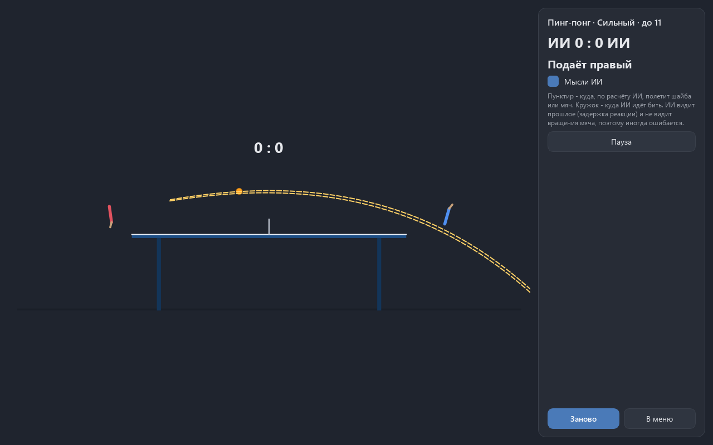

# PinPongAi - ping-pong and air hockey against a self-taught AI

Version 0.1.0. Russian version with more detail: [README.ru.md](README.ru.md).

Code, tests and docs are written by Claude (Anthropic) in Claude Code. Ideas, testing and decisions - Alexey.

Two games in one program: ping-pong seen from the side and air hockey seen from above. The
opponent is a small neural network that first learned to copy a bot and then improved by
playing against itself and its past versions. It is honest: its paddle has the same speed
and acceleration limits as yours, it sees the ball with a reaction delay and a small eye
error, and it cannot see the ball's spin at all.

## In the window

| | Air hockey | Ping-pong |
|---|---|---|
| view | from above | from the side |
| mouse | mallet in your half | paddle behind your end of the table |
| mouse wheel | - | paddle tilt |
| match | to 7 | to 11, win by 2 |
| second player | arrow keys | arrows, PageUp and PageDown tilt |

Modes: versus AI, two players (the second on the keyboard), AI vs AI. Levels: novice,
medium, strong. Space pauses, Esc opens the menu. "AI thoughts" draw a dashed line where the
AI expects the ball or puck to go and a circle where it moves to hit.

The cursor is never captured. The mouse only shows a point; the mallet or paddle travels
there with the same acceleration limits as the AI's, it does not jump to the cursor.

The ping-pong serve is simple: the server hits the tossed ball straight to the opponent's
side. Settings offer the serve by the rules (bounce on your own side first). The AI was
trained on the simple serve, so the strict rule applies to people only.

## Why the physics is written from scratch

Both games run on one 2D engine with a fixed 1/240 s step. The window can draw at 30 or 144
frames per second; the game still makes 240 steps per second, so a match with the same
inputs plays out the same way. The engine works on numpy arrays of many matches at once:
the window uses one, training uses 256, and it is the same code. A test checks that a match
inside a batch and the same match alone agree bit for bit.

Collisions are continuous: the engine finds the moment inside the step when the distance to
the wall equals the radius. Tests fire the puck at up to 5000 units per second (the rink is 2
units long); it never leaves the rink or passes through a mallet. The ball bounces with
Coulomb friction, so a brushing stroke puts spin on it, and topspin dives (Magnus effect) and
kicks forward on the bounce.

Mutation check: 27 deliberate breakages of the physics (restitution, friction, spin sign,
goals, scoring and serve rules, speed limits, the clock). All 27 are caught.

## How the AI works

- **Eyes.** A ring buffer of ball states. The AI reads it with a delay: novice 0.21 s,
  medium 0.14 s, strong 0.09 s, plus an eye error of 3, 1.5 and 0.6 cm. No spin in the buffer.
- **Hint.** An explicit trajectory forecast: a closed formula for the puck (exact to 5 mm with
  elastic walls), an arc for the ball with the spin it gets from the table (median error
  3.5 cm; it was 7 cm before that spin was taken into account).
- **Network.** A numpy MLP, 16 or 20 inputs, layers 16x16 (air hockey) or 32x32
  (ping-pong). The output is the desired acceleration, limited by the same physics as the
  human's mouse.
- **Training.** First imitation of the predictor bot (153,600 examples), then the
  cross-entropy method in self-play: 32 weight sets per generation, 8 short games each
  against the predictor, the follower and a league of past versions. Without the imitation
  step, 50 generations did not beat a mallet standing still (-1.3 goals per 12 s against the
  predictor). With it the first generation was already at -0.7.

## AI passport

PASSPORT_TABLE

## Running

    python -m venv .venv
    .venv\Scripts\pip install -r requirements-dev.txt
    .venv\Scripts\python main.py
    .venv\Scripts\python -m pytest -q
    .venv\Scripts\python main.py --selftest result.txt

Training and passport: `python -m game.train run|export|passport --game hockey|pong`
(see README.ru.md). Build: `python build.py`.

License: MIT.
