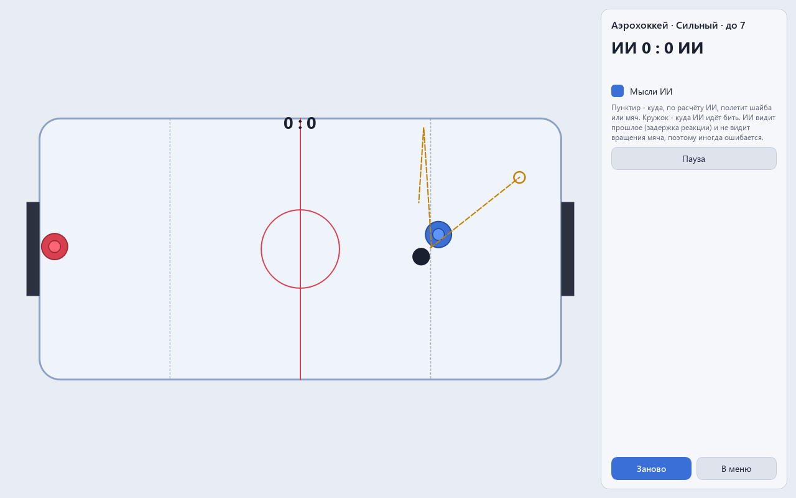

# PinPongAi - пинг-понг и аэрохоккей против ИИ, который научился играть сам

Версия 0.1.0. English: [README.md](README.md).

     

Код, тесты и документация этого проекта написаны Claude (Anthropic) в Claude Code. Идеи, проверка и решения - Алексей.

Две игры в одной программе: пинг-понг сбоку и аэрохоккей сверху. Соперник - небольшая
нейросеть, обученная сначала повторять бота, а потом - игрой с собой и с прошлыми версиями
себя. ИИ честный: у его ракетки те же пределы скорости и ускорения, что у вашей, он видит
мяч с задержкой реакции и с ошибкой глаза, а вращения мяча не видит вовсе.

## Что в окне

| | Аэрохоккей | Пинг-понг |
|---|---|---|
| вид | сверху | сбоку |
| мышь | бита в своей половине | ракетка за своим краем стола |
| колесо мыши | - | наклон ракетки |
| счёт | до 7 | до 11, с разницей в 2 |
| второй игрок | стрелки | стрелки, PageUp и PageDown - наклон |

Режимы: против ИИ, вдвоём (второй на клавиатуре), ИИ против ИИ. Уровни: новичок, средний и
сильный. Пробел - пауза, Esc - меню. «Мысли ИИ» рисуют пунктиром, куда ИИ ждёт мяч или
шайбу, и кружком - куда он идёт бить.

Курсор не захватывается. Мышь только показывает точку, бита или ракетка едет к ней, а не
прыгает за курсором: разгон и торможение ограничены так же, как у ИИ. Увели мышь с поля -
бита стоит у края.

Подача в пинг-понге простая: подающий бьёт подброшенный мяч сразу на сторону соперника. В
настройках есть подача по правилам (сначала отскок на своей стороне). ИИ учился на простой
подаче, поэтому строгое правило действует только для людей.

## Почему физика своя

Обе игры идут на одной 2D-физике с фиксированным шагом 1/240 с. Окно может рисовать 30 или
144 кадра в секунду, а игра всё равно делает 240 шагов в секунду, поэтому партия с теми же
командами проходит одинаково. Часы считают шаги от общего прошедшего времени, а не от
остатка: так число шагов не зависит от того, какими кусками время пришло.

Физика считает массивы numpy сразу из многих партий: окно берёт одну партию, обучение -
256 сразу, и это один и тот же код. Проверка сравнивает партию в пачке и ту же партию одну -
они совпадают бит в бит.

Удары ищутся непрерывно. Простая физика сдвигает шайбу и потом проверяет, не залезла ли она
в борт, - быстрая шайба за один шаг перепрыгивает тонкий борт. Здесь ищется момент внутри
шага, когда расстояние до борта станет равно радиусу. Проверки бьют шайбой со скоростью до
5000 единиц в секунду (поле длиной 2) - она не покидает поле и не проходит сквозь биту.

Мяч в пинг-понге отскакивает с трением по Кулону. Ракетка, идущая вверх по мячу, закручивает
его: верхнее вращение по эффекту Магнуса прижимает мяч к столу и толкает вперёд при
отскоке, нижнее держит в воздухе.

| Закон | Что проверяет |
|---|---|
| упругий удар без трения | скорость относительно поверхности сохраняется |
| удар с трением | энергия не растёт |
| отражение от борта | угол падения равен углу отражения |
| пачка и одна партия | совпадают бит в бит |
| 30 и 144 кадра в секунду | то же число шагов, та же партия |
| верхнее и нижнее вращение | мяч падает раньше и позже, чем без вращения |

Мутационная проверка: 27 нарочных поломок физики (упругость, трение, знак вращения, ворота,
правила очка и подачи, пределы скорости, часы). Все 27 ловятся проверками. Три сначала
выжили и закрыты новыми законами: штанга, задетая краем шайбы; предел скорости биты при
полном газе; строка в расчёте времени удара, которая оказалась лишней.

Первая найденная законом ошибка: правило 7 секунд (шайба, простоявшая на одной половине,
уходит сопернику) в одном шаге передавало шайбу туда и сразу обратно. Маски сторон
считались после переноса шайбы - теперь до.

## Как устроен ИИ

**Глаза.** Каждый шаг положение и скорость мяча пишутся в кольцевой буфер. ИИ читает из него
состояние с задержкой: новичок - 0.21 с, средний - 0.14 с, сильный - 0.09 с. К увиденному
добавляется ошибка глаза (3, 1.5 и 0.6 см). Вращения в буфере нет. Своя ракетка видна без
задержки - это ощущение своей руки. Законы: ИИ решает одинаково, если мяч в мире подменить
после записи в глаза, и одинаково при любом вращении мяча.

**Подсказка - явный прогноз.** Шайба: формула. С трением путь по x и по y убывает в одной
пропорции, поэтому точка на линии защиты - это прямая, сложенная «гармошкой» между бортами.
С упругими бортами прогноз совпадает с физикой до 5 мм. Мяч: дуга с тяжестью, приближённым
сопротивлением воздуха и вращением, которое мяч получит от стола при отскоке. Без учёта этого
вращения медиана ошибки была 7 см, с ним - 3.5 см (ракетка длиной 16 см). Вращение,
пришедшее от удара соперника, ИИ не видит - на крученых мячах он ошибается, как человек.

**Сеть.** MLP на numpy: 16 входов у аэрохоккея (шайба, своя бита, соперник, подсказка),
20 у пинг-понга; слои 16×16 и 32×32, tanh. Выход - желаемое ускорение биты (и наклона
ракетки), его ограничивает та же физика, что и мышь человека.

**Обучение.**

1. Подражание. Сеть учится повторять команды бота-«предсказателя» по тем же признакам,
   что видит сама: 153 600 примеров за 40 с игры 64 партий.
2. CEM (метод перекрёстной энтропии) в игре с собой. В поколении 32 набора весов, у каждого
   8 партий по 12 с (пинг-понг - по 16 с): 3 с «предсказателем», 1 со «следящим», 4 с
   прошлыми версиями из лиги. Условия у всех наборов одинаковые - разница оценок идёт от
   весов, а не от везения.
3. Оценка - разница очков плюс немного за касания и удачные удары.

Сначала обучение шло без подражания. За 50 поколений сеть научилась касаться шайбы, но
против «предсказателя» играла не лучше биты, стоящей на месте: -1.3 гола за 12 с. После
подражания - -0.7 в первом же поколении.

Уровни - снимки одного обучения (новичок - ранний, средний - середина, сильный - конец) с
задержкой и ошибкой глаза своего уровня.

## Паспорт ИИ

PASSPORT_TABLE

## Запуск

    python -m venv .venv
    .venv\Scripts\pip install -r requirements-dev.txt
    .venv\Scripts\python main.py
    .venv\Scripts\python -m pytest -q
    .venv\Scripts\python main.py --selftest итог.txt

Обучение и паспорт (потоки BLAS - по одному):

    python -m game.train run --game hockey --run runs/hockey --probe     # 2 поколения и прогноз
    python -m game.train run --game hockey --run runs/hockey             # с места, если прервано
    python -m game.train run --game hockey --nohint --run runs/hockey-nohint
    python -m game.train export --game hockey --run runs/hockey --nohint-run runs/hockey-nohint
    python -m game.train passport --game hockey --games 200

Сборка: `python build.py` (PyInstaller, portable-архив и установщик NSIS).

Лицензия MIT.
